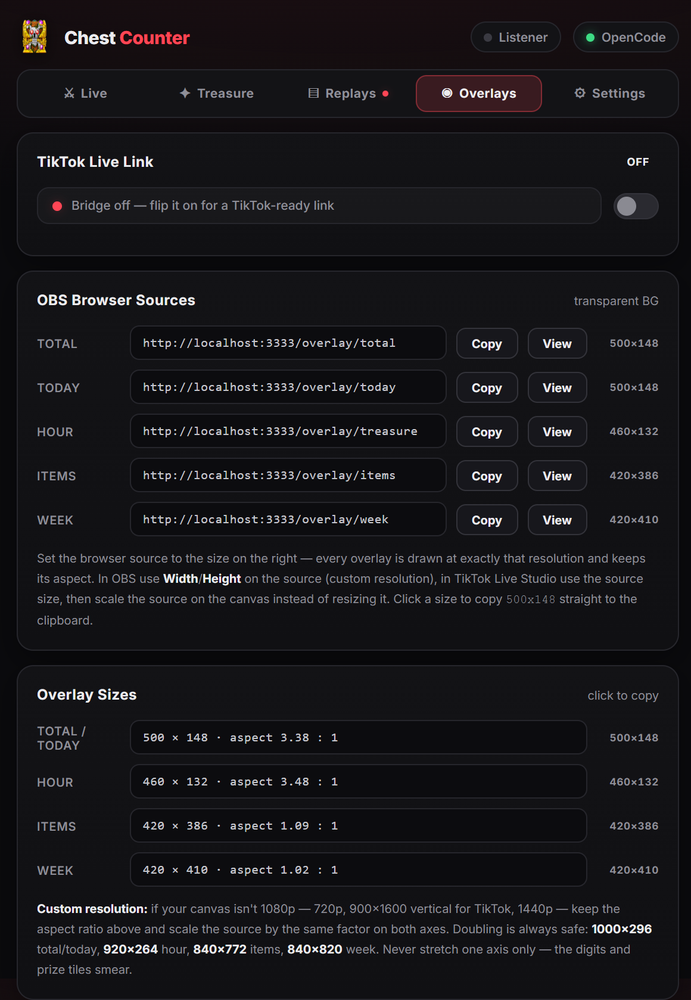

<div align="center">

# Chest Counter

**Fortnite chest tracker with live TikTok / OBS overlays, replay auditing and Pirate Treasure hunt stats**


</div>

---

## What it does

- **Counts chests as you play** — a listen-only key hook counts your interact tap, and an on-screen prompt watcher only credits taps made while a chest is actually in range
- **Audits every finished match** from Fortnite's own `.replay` files, and only adds the chests the live counter missed — no double counting
- **Serves stream overlays** over HTTP for OBS browser sources and TikTok Live Studio, with the exact pixel size each one is drawn at
- **Tracks Pirate Treasure odds** — chests since your last drop for every reward tier, with the live week's prize artwork
- **Knows the Treasure Hour schedule** — the next window, the four after it, and a countdown that flips the boosted odds on its own
- **Bridges to TikTok** one click, via a Cloudflare quick tunnel (no account needed)

Everything is passive: no game memory reads, no injection, no input automation, no screen or audio capture. The two live signals are a keyboard event and a screenshot of the interact prompt, and the third source is the replay files Fortnite already writes to disk.

---

## Screenshots

**Live panel** — live counters, detection state, the next Treasure Hour


**Replays** — every finished match parsed from its `.replay` file, with the live-vs-replay audit


**Treasure Hunt** — chests since your last drop for every reward tier, plus the hour schedule


**Weekly prize crews** — the live week's set with artwork, and upcoming weeks


**Overlays** — browser source URLs with the exact size for OBS and TikTok



---

## Download

**[Latest release →](https://github.com/MyNameIsKajiu/Fortnite-Chest-Counter/releases/latest)**

Grab `Chest-Counter-1.0.1-win-x64.zip`, unzip anywhere, run `Chest Counter.exe`. No installer, no dependencies.

**Requirements**

- Windows 10 / 11 (64-bit)
- Fortnite replays enabled (`Settings › Game › Replays`) for the post-match audit

The first time you start the TikTok bridge it downloads `cloudflared.exe` (~55 MB, Cloudflare's own tool) into `%APPDATA%\Chest Counter`. Nothing else touches the network.

---

## Overlays

| Overlay | URL | Size | For |
|---|---|---|---|
| Total chests | `/overlay/total` | **500 × 148** | OBS + TikTok |
| Today's chests | `/overlay/today` | **500 × 148** | OBS + TikTok |
| Next Treasure Hour | `/overlay/treasure` | **460 × 132** | OBS + TikTok |
| Treasure items found | `/overlay/items` | **420 × 386** | OBS + TikTok |
| Weekly prize crew | `/overlay/week` | **420 × 410** | OBS + TikTok |

Base URL is `http://localhost:3333`, or the `https://…trycloudflare.com` link when the bridge is on.

The two counters show **only the number** — no label text — so the digits fill the scroll.

### OBS

1. **Add → Browser**
2. URL, e.g. `http://localhost:3333/overlay/total`
3. Set **Width** and **Height** to the size above (custom resolution)
4. Leave background transparent, then move/scale the source on your canvas

### TikTok Live Studio

1. Turn on the bridge in **Overlays**, copy a link
2. **Add link** → paste → set the source to the size above
3. Drag it where you want it on the 1080 × 1920 canvas

### Custom canvas resolution

Every overlay is drawn at exactly its listed size. To fit a different canvas, scale **both axes by the same factor** — 2× gives 1000×296 (total/today), 920×264 (hour), 840×772 (items), 840×820 (week). Stretching one axis only smears the digits and prize tiles.

---

## How it works

| Component | What it does |
|---|---|
| `hook.ps1` | Low-level keyboard listener (`WH_KEYBOARD_LL`) — reports key up/down only, never injects input |
| `chest-probe.ps1` | Crops the interact region, runs Windows OCR, reports whether "Search Chest" is on screen |
| `replay.js` | Watches `%LOCALAPPDATA%\FortniteGame\Saved\Demos`, parses finished matches in a child process |
| `replay-reader/` | MIT Fortnite replay reader (vendored, see `NOTICE.md`) |
| `server.js` | Express on `127.0.0.1:3333` — overlays, SSE state stream, counters, treasure odds |
| `treasure-schedule.js` | The weekly Treasure Hour cadence, computed locally |
| `treasure-weeks.js` | The five weekly prize crews and their artwork |
| `bridge.js` | Cloudflare quick tunnel for TikTok-ready https links |
| `main.js` | Electron main process — window, tray, helpers, settings |

**Counting rule:** the live tap-gate is the instant counter. When a replay finishes, the app matches it to the match window in `FortniteGame.log`, asks how many taps were already counted inside that window, and adds only the difference. A match played while the app was closed adds in full.

---

## Pirate Treasure

Chests are tallied since your last drop for each tier, using Epic's published per-chest odds:

| Reward | Base odds | Treasure Hour |
|---|---|---|
| Weekly Gold Outfit | 1 in 1,562,500 | 7.5× |
| Pirate Shop Access | 1 in 137,500 | 1.5× |
| Weekly Vehicle & Decal | 1 in 7,813 | 10× |
| Weekly Pickaxe / Back Bling | 1 in 568 | — |
| Weekly Jam Track | 1 in 391 | — |
| Weekly Loading Screen | 1 in 272 | — |
| Gizmo (any, repeatable) | 1 in 127 | — |

**Treasure Hours** are calculated locally, not scraped: this season every window runs **Saturday 21:00–23:00 UTC** and **Sunday 02:00–04:00 UTC** — 9–11 PM and 2–4 AM in CET. The countdown, the four-window list and the boosted odds all follow that cadence. If Epic announces a one-off window, the Treasure tab has an **Override** field for it.

**Weekly prizes** flip at Epic's Sunday reset (07:00 UTC). Prize artwork is fetched once from the public CDN and cached in `%APPDATA%\Chest Counter\images` — no Epic assets are redistributed with this app.

---

## Building from source

> Node.js ≥ 18 needed. The release zip does not contain sources.

```bash
npm install
npm start            # dev mode
npm run build        # dist/Chest Counter-win32-x64  (slim)
npm run release      # release/Chest-Counter-<version>-win-x64.zip

powershell -File ./build-manual.ps1 -Full   # also ship cloudflared.exe (offline tunnel)
```

The default build is slim: English only (`en-US.pak`), no tunnel binary. Both are fetched or dropped at runtime without changing behaviour.

---

## Privacy

- **Local only.** The server binds `127.0.0.1` — nothing on your network can reach it.
- **The tunnel is the only way out**, and it is opt-in. Through it, the allowlist is five overlay pages, prize artwork, the state stream and a read-only state snapshot. The panel, the settings, the replay history and every write endpoint answer `404` to tunnel traffic.
- **No screen or audio capture.** Removed in 1.0.1 — the app never asks for a display-capture permission.
- **No telemetry, no analytics, no accounts.** The only outbound requests are the prize artwork and the optional `cloudflared` download.
- **Your data stays in `%APPDATA%\Chest Counter`** — `counts.json`, `treasure.json`, `config.json`, `replay-history.json`. Delete that folder to start clean.
- Replay files are read, never modified.

---

## License

MIT — see [LICENSE](LICENSE). Vendored components are listed in [NOTICE.md](NOTICE.md).

---

## Disclaimer

This project is **not affiliated with, endorsed by, or associated with Epic Games or Fortnite.** Fortnite is a trademark of Epic Games, Inc. All game names, assets and trademarks belong to their respective owners.

The app is passive — keyboard events, an OCR region, and replay files on disk. It does not modify the game, its files, or its memory. How you use it is your responsibility.

---

<div align="center">
Built for the chest grind.
</div>
