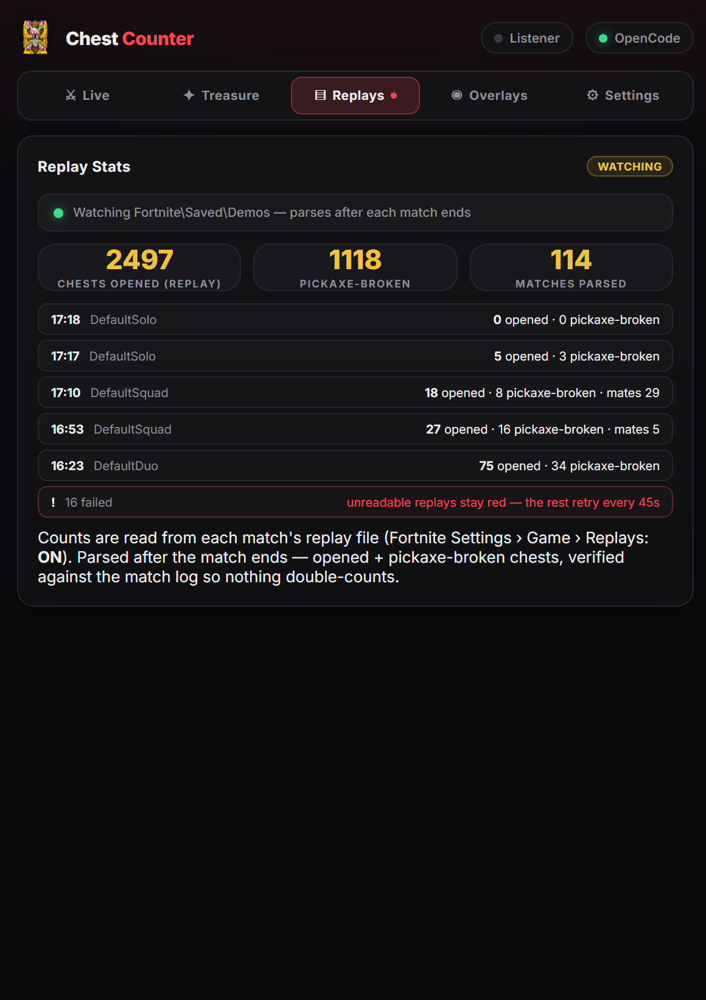
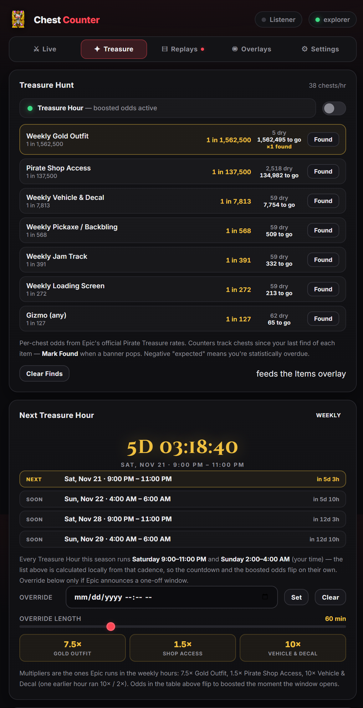

<div align="center">

# 🗃️ Chest Counter

**Fortnite chest tracker with live TikTok overlay, OBS browser sources & Pirate Treasure hunt stats**


</div>

---

## What it does

Chest Counter is a lightweight Electron app for Fortnite streamers that:

- **Counts chests** you open in real-time — automatically, via screen OCR + keyboard hook
- **Reads `.replay` files** to pull chest counts from past matches
- **Serves live browser sources** (OBS, StreamElements, etc.) at `localhost:3333`
- **Bridges to TikTok Live Studio** via a Cloudflare quick tunnel — no account needed, one click
- **Tracks Pirate Treasure event odds** — shows how many chests until your next expected drop for every reward tier (Gold Outfit, Gizmo, Jam Track, etc.)
- **Treasure Hour scheduler** — arms a boost window that adjusts odds automatically

Everything is **read-only / passive** — no memory injection, no game process access, just screen pixels and replay files.

---

## Screenshots

**Live Panel — real-time chest counter with detection controls**


**Replays — parsed match history with chest + pickaxe stats**


**Treasure Hunt — per-reward odds tracker with Treasure Hour scheduler**


---

## Download

👉 **[Latest Release →](../../releases/latest)**

Download `Chest_Counter-win32-x64.zip`, unzip anywhere, run `Chest Counter.exe`. No install needed.

**Requirements:**
- Windows 10 / 11 (64-bit)
- No dependencies — everything is bundled

---

## How it works

| Component | What it does |
|---|---|
| `hook.ps1` | Low-level keyboard hook (`WH_KEYBOARD_LL`) — detects when you press your interact key (default: `E`) |
| `chest-probe.ps1` | Crops your screen around the interact prompt, runs Windows OCR, fires when it sees "Search Chest" |
| `server.js` | Express server on port `3333` — serves overlay pages + SSE stream for live counter updates |
| `bridge.js` | Wraps `cloudflared.exe` to expose `localhost:3333` as a public `trycloudflare.com` URL for TikTok |
| `replay.js` | Parses Fortnite `.replay` binary files to match past chest opens to live-counted sessions |
| `main.js` | Electron main process — wires everything together, manages tray icon, spawns PS1 helpers |

---

## OBS Browser Source Setup

1. Open OBS → Add Source → **Browser**
2. URL: `http://localhost:3333/overlay`
3. Width: `400` Height: `200`
4. Done — counter updates live as you play

---

## TikTok Live Studio Setup

1. Open Chest Counter
2. Click **Start Tunnel**
3. Copy the `trycloudflare.com` URL
4. In TikTok Live Studio → Add Link → paste URL
5. The overlay is now publicly accessible for your stream

---

## Pirate Treasure Tracker

Tracks chests opened since your last drop for each reward tier using Epic's official per-chest odds:

| Reward | Base Odds | Treasure Hour Boost |
|---|---|---|
| Weekly Gold Outfit | 1 in 1,562,500 | 7.5× |
| Pirate Shop Access | 1 in 137,500 | 1.5× |
| Weekly Vehicle & Decal | 1 in 7,813 | 10× |
| Weekly Pickaxe / Backbling | 1 in 568 | — |
| Weekly Jam Track | 1 in 391 | — |
| Weekly Loading Screen | 1 in 272 | — |
| Gizmo (any, repeatable) | 1 in 127 | — |

---

## Building from Source

> You'll need Node.js ≥ 18 and the source files (not included in the binary release).

```bash
npm install
npm start          # dev mode
npm run build      # builds the win32-x64 package
npm run release    # builds + zips for release
```

---

## Privacy

- No data ever leaves your machine (except the optional Cloudflare tunnel you explicitly start)
- No analytics, no telemetry, no accounts
- `counts.json` and `treasure.json` are stored in `%APPDATA%\Chest Counter`

---

## License

MIT — do whatever you want with it.

---

## ⚠️ Disclaimer

This project is **not affiliated with, endorsed by, or in any way associated with Epic Games or Fortnite.**
Fortnite is a registered trademark of Epic Games, Inc. All game-related assets, names, and trademarks belong to their respective owners.

**Use at your own risk.** The developers of Chest Counter take no responsibility for any consequences arising from its use, including but not limited to account actions, bans, or violations of Epic Games' Terms of Service. This tool operates passively (screen reading + replay parsing only) and does not modify game files or memory, but you are solely responsible for how you use it.

---

<div align="center">
Made for Fortnite grinders 🏴‍☠️
</div>
