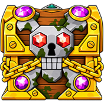
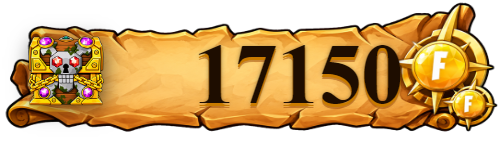
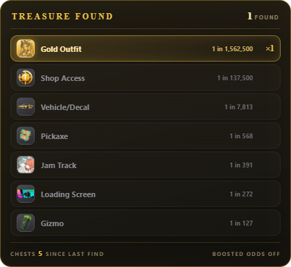
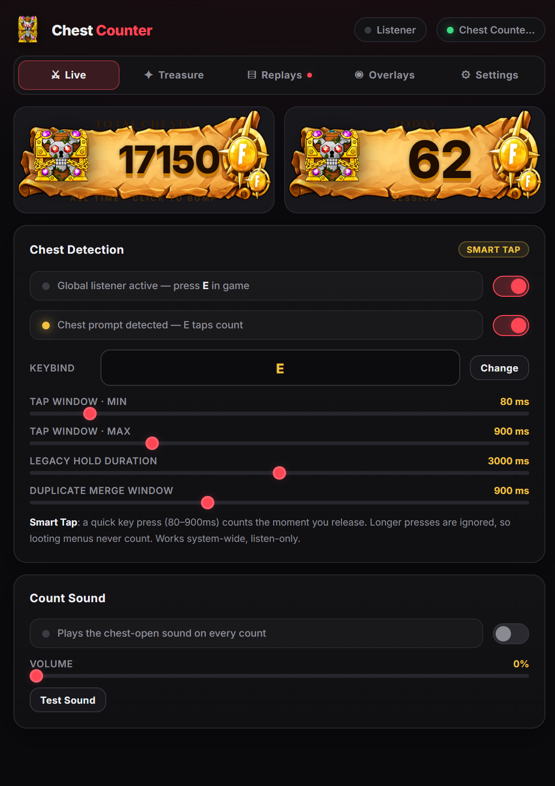
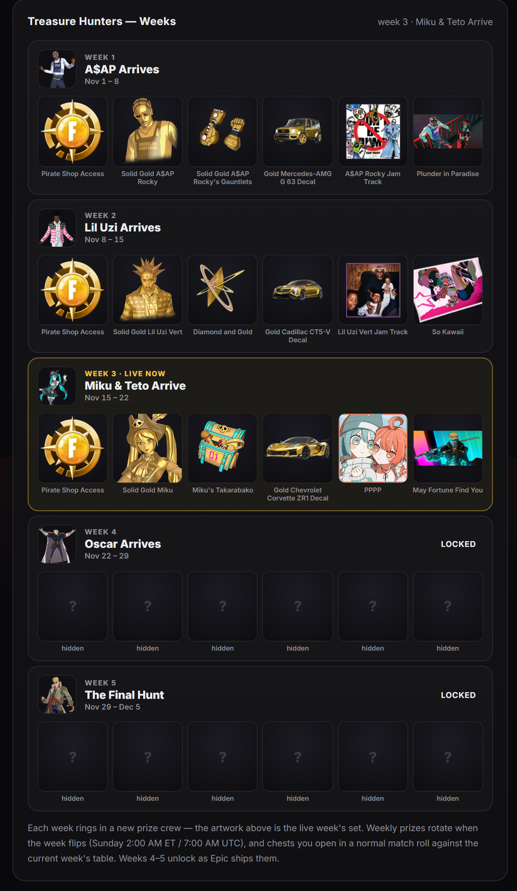

<div align="center">



# Chest Counter

[](../../releases/latest) [](../../releases)  [](LICENSE)

**Counts every chest you open in Fortnite, live, with overlays for OBS and TikTok Live Studio.**

&nbsp;&nbsp;&nbsp;&nbsp;

[**⬇ Download Chest-Counter-1.1.0-win-x64.zip**](../../releases/latest) · Windows 10 / 11 · free · no install

</div>

---

Chest Counter counts the chests you open as you open them, keeps a running total, and shows the figures over your stream with no background and no frame. It also tracks the **Pirate Treasure** hunt: how many chests since your last drop for every reward tier, the live week's prize crew, and when the next **Treasure Hour** starts.

> It counts the chests **you opened**. It does not show where chests are on the map.

## How it works (and why it is safe)

Three read-only sources, no game client access:

- ✅ **Your interact key.** A listen-only low-level keyboard hook sees the key you bound to *interact* going down and up. It never sends input, never presses anything, never automates play.
- ✅ **A small screenshot of the interact prompt.** Windows OCR checks whether *Search Chest* is on screen, so a key press only counts when a chest is really in range. A press while you are just looting a floor counts nothing.
- ✅ **The replay files Fortnite writes.** After each match the `.replay` file in `%LOCALAPPDATA%\FortniteGame\Saved\Demos` is parsed in a separate process, read-only, and only the chests the live counter missed are added.
- ✅ **No access to the game's memory.** Nothing is read from, written to, or injected into the Fortnite process. There is no `OpenProcess`, no DLL, no driver, no overlay injection.
- ✅ **No input automation.** The hook is a listener. It cannot move your mouse or press a key.
- ✅ **Nothing is sent anywhere.** No account, no login, no telemetry, no analytics. The only outbound requests are the prize artwork and — only if you switch the TikTok bridge on — the tunnel helper.
- ✅ **The local server is closed to your network.** It binds `127.0.0.1` only. Your phone, your friends and the rest of the LAN cannot reach it.

> [!IMPORTANT]
> **Turn replays on in Fortnite** — *Settings → Game → Replays → Record Replays: **On***. The live counter works without them, but replays are what catch the chests it missed, and what fill your match history.

Because the replay is only complete when the match ends, the post-match audit lands **a few seconds after** the match. The live tap counter is what moves the numbers while you play.

## Getting started

1. Download **[`Chest-Counter-1.1.0-win-x64.zip`](../../releases/latest)** and unzip it anywhere writable — Desktop, Documents, a folder of your own. There is no installer.
2. Turn on replays in Fortnite (see above).
3. Run **`Chest Counter.exe`**.
   > Windows may show *"Windows protected your PC"* because the exe is not signed. Click *More info → Run anyway*.
4. The panel opens on the **Live** tab. The key listener and the prompt gate are already on.
5. Leave it running while you play. It lives in the system tray — closing the window does not stop the counter.

<p align="center"></p>

> [!TIP]
> The counters show **numbers only** — no label text — so the digits fill the frame and blend into the game's own HUD.

## The window

Five tabs: **Live**, **Treasure**, **Replays**, **Overlays** and **Settings**. The header shows whether the listener is on and which app has focus.

- **Live**: total chests, today's chests, chest detection state, and the count sound.
- **Treasure**: chests since your last drop for every reward tier, the next Treasure Hour with a countdown, and the weekly prize crews.
- **Replays**: every finished match, parsed, with the live-versus-replay audit.
- **Overlays**: the browser-source URLs, their exact pixel sizes, and the TikTok bridge.
- **Settings**: manual control of the counters.

### Chest Detection

A press counts when three things line up: the key is your bound interact key, the press is inside the **tap window** (80–900 ms by default), and the chest prompt was on screen. Presses longer than the window are ignored, so holding a key for a loot menu never counts.

- **Duplicate merge window** (900 ms) folds a double-tap on one chest into a single chest.
- **Count sound** plays the chest-open sound on every count, off by default.

<p align="center"></p>

## The overlays

All five are plain pages on `http://localhost:3333`, drawn at exactly the size below and transparent by default.

| Overlay | URL | Size |
|---|---|---|
| Total chests | `/overlay/total` | **500 × 148** |
| Today's chests | `/overlay/today` | **500 × 148** |
| Next Treasure Hour | `/overlay/treasure` | **460 × 132** |
| Treasure items found | `/overlay/items` | **420 × 386** |
| Weekly prize crew | `/overlay/week` | **420 × 410** |

### OBS

1. **Sources → + → Browser**
2. Paste the URL, e.g. `http://localhost:3333/overlay/total`
3. Set **Width** and **Height** to the size above — these are the sizes the pages are drawn at
4. Leave the background transparent, then drag and scale the source on your canvas

### TikTok Live Studio

TikTok only accepts a public `https://` link, so `localhost` cannot be pasted directly.

1. Open the **Overlays** tab and switch on **TikTok Live Link**
2. Wait for the pasted-ready `https://…trycloudflare.com` link, then **Copy** the overlay you want
3. **Add link** in TikTok Live Studio → paste → set the source to the size above
4. Drag it where you want it on the 1080 × 1920 canvas

> [!NOTE]
> The link is different every session — copy it again after a restart. The first time you switch the bridge on, it downloads `cloudflared.exe` (~55 MB, Cloudflare's own tool) into `%APPDATA%\Chest Counter`. The bridge is **off by default**: it is the only thing in the app that puts a page on the public internet, and you should be the one to turn it on.

### Custom canvas

Keep the aspect ratio and scale both axes by the same factor. Doubling is always safe: **1000 × 296** total/today, **920 × 264** hour, **840 × 772** items, **840 × 820** week. Stretching one axis only smears the digits and the prize tiles.

## Treasures

Chests are tallied since your last drop for each tier, using Epic's published per-chest odds:

| Reward | Base odds | Treasure Hour |
|---|---|---|
| Weekly Gold Outfit | 1 in 1,562,500 | 7.5× |
| Pirate Shop Access | 1 in 137,500 | 1.5× |
| Weekly Vehicle & Decal | 1 in 7,813 | 10× |
| Weekly Pickaxe / Back Bling | 1 in 568 | — |
| Weekly Jam Track | 1 in 391 | — |
| Weekly Loading Screen | 1 in 272 | — |
| Gizmo (any, repeatable) | 1 in 127 | — |

**Treasure Hours** are computed locally, not scraped: this season every window runs **Saturday 21:00–23:00 UTC** and **Sunday 02:00–04:00 UTC** — 9–11 PM and 2–4 AM CET. The countdown, the next four windows and the boosted multipliers all follow that cadence, and the boosted odds switch on by themselves. If Epic announces a one-off window, the Treasure tab has an **Override** field for it.

<p align="center"></p>

**Weekly prizes** flip at Epic's Sunday reset (07:00 UTC). Prize artwork is fetched once from the public CDN and cached in `%APPDATA%\Chest Counter\images` — no Epic assets are redistributed with this app.

## Your data

Everything is stored in `%APPDATA%\Chest Counter`:

| File | Content |
|---|---|
| `counts.json` | Your totals and today's count. |
| `treasure.json` | Your per-tier counters and what you have marked as found. |
| `config.json` | Your settings — keybind, windows, sound, bridge. |
| `replay-history.json` | Every match already audited, so nothing is counted twice. |
| `images\` | Cached prize artwork. |
| `cloudflared.exe` | The tunnel helper, only if you used the TikTok bridge. |

The folder survives upgrades. Delete it to start clean, or keep just `counts.json` and `treasure.json` to keep your history.

## FAQ

**Nothing is counted.** Check that the listener switch is on, that the keybind matches your in-game interact key, and that the chest prompt gate is on. If the prompt is not detected, taps are ignored by design.

**Does it read the game's memory or inject anything?** No. A keyboard listener, an OCR check of a screen region, and replay files on disk. Nothing touches the Fortnite process.

**Are ammo boxes counted?** No. Chests only. The replay audit counts chests opened, not ammo boxes or floor loot.

**My total jumped on first launch.** Expected: with replays on, the app audits the replays already on your PC and adds the chests it finds, so your history starts from what is on disk.

**A match is missing from Replays.** A replay is unreadable if Fortnite was closed mid-match (it never wrote the decryption key), or if a game update changed the format. Unreadable replays stay listed and retry every 45 seconds.

**Can a match be counted twice?** No. Each audited match is remembered in `replay-history.json`, and the audit only adds the difference against what the live counter already recorded in that window.

**The TikTok link stopped working.** The quick-tunnel URL changes every session. Switch the bridge off and on again in the Overlays tab, copy the new link, and paste it into TikTok Live Studio.

**The overlay is cut off or blurry.** Give the browser source the exact size from the table. Scaling one axis only distorts it; scale both by the same factor instead.

**The window stays in the tray.** Close hides to tray so the counter keeps counting. Use the tray icon to bring it back, or quit from the tray menu.

**Is it bannable?** It does not modify the game, its files or its memory, and it never sends input — it reads a key event, a screen region and replay files. That said, this is an unofficial tool and you run it at your own risk.

## Build it yourself

Needs **Node.js 18+**. The release zip does not contain sources.

```bash
npm install
npm start          # dev mode
npm run build      # dist/Chest Counter-win32-x64  (slim)
npm run release    # release/Chest-Counter-<version>-win-x64.zip
```

The default build is slim: English locale only, no tunnel binary. `build-manual.ps1 -Full` ships `cloudflared.exe` so the bridge works offline. The GitHub Actions workflow builds on every tag and attaches the zip to the release with the text of [`RELEASE_NOTES.md`](RELEASE_NOTES.md).

## License

[MIT](LICENSE) — use it, fork it, ship it. Just keep the copyright notice.

## Credits

Built by [ForKaiju](https://github.com/ForKaiju), and this list is deliberately honest about the rest:

| Who | What they did |
|---|---|
| [ForKaiju](https://github.com/ForKaiju) | The idea, the requirements, every decision that shaped the app, and all the testing against a real client. |
| **Claude** (Anthropic) | Pair-programmed the application with ForKaiju — the Electron shell, the server, the replay audit, the bridges, and the writing of this documentation. |
| **ollie** (OpenCode agent) | Ran those pair sessions: wrote and reviewed the code, verified the toggles and the bridge with real input events, packaged and audited the release zip. |

Third-party, all of it vendored or downloaded rather than reimplemented:

| Project | Used for | License |
|---|---|---|
| [replay-reader](https://github.com/xNocken/replay-reader) by xNocken | Fortnite replay parsing, vendored in `replay-reader/` | MIT |
| `oodle-ooz/` | Oodle decompression | see `oodle-ooz/LICENSE` |
| [cloudflared](https://github.com/cloudflare/cloudflared) by Cloudflare | The TikTok tunnel, downloaded at runtime and never redistributed | Apache 2.0 |
| [Electron](https://www.electronjs.org/) / [Express](https://expressjs.com/) | Desktop shell and local server | MIT |

Prize artwork and the treasure schedule come from [fortnite.bot](https://fortnite.bot). Full third-party text is in [NOTICE.md](NOTICE.md).

This project is not affiliated with, endorsed by or sponsored by Epic Games. Fortnite is a trademark of Epic Games, Inc.
